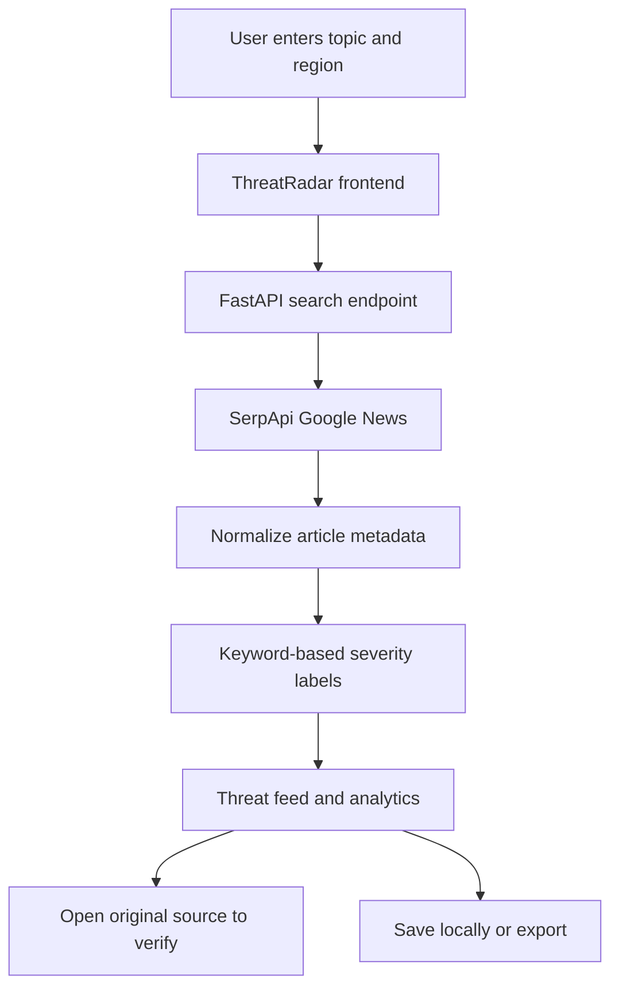

# ThreatRadar
### Cyber Threat Intelligence · Search, Triage, Verify

ThreatRadar is a source-first cyber threat intelligence dashboard that helps users discover and review current cybersecurity reporting from the open web. It uses **SerpApi's Google News engine** to retrieve articles, then organizes results with transparent keyword-based severity labels and lightweight analytics.

> **Live demo:** https://basicthreatradar.onrender.com  
> **Core principle:** identify useful reporting, inspect the original source, and verify context before acting.

---

## Why ThreatRadar?

Cybersecurity reporting is spread across publishers, advisories, and breaking-news pages. ThreatRadar brings query-driven discovery, explainable triage, and source links into one workspace—without presenting a headline-based estimate as a verified security finding.

The project is designed as a lightweight, deployable hackathon application using a FastAPI backend and a responsive HTML/CSS/JavaScript frontend.

## Dashboard capabilities

### Discover
- Search public cybersecurity reporting using free-text topics, campaign names, and CVE identifiers.
- Choose a search region: **India, United States, United Kingdom, Canada, or Australia**.
- Use quick-scan profiles for zero-day exploits, ransomware, phishing, data breaches, critical CVEs, and cloud security.
- Review source names, publication dates, article summaries, thumbnails when available, and original publisher links.

### Triage and analyze
- Assign **Critical, High, Medium, or Low** labels using readable keyword rules applied to article titles and snippets.
- Filter the feed by severity or text.
- Sort by source order, relative severity, or publisher name.
- Review a severity distribution, publisher coverage, and a relative signal index for the current result set.
- See report counts, high-priority counts, source coverage, and the most recent successful scan.

### Save and export
- Save useful reports to a personal intelligence board stored in the browser.
- Revisit the last six successful search queries.
- Export the visible feed as **CSV** or **JSON**.
- Export saved intelligence as JSON.
- Refresh the current query without rebuilding the scan settings.

### Interface and usability
- Dark cyber-operations interface with cyan, violet, and blue accents.
- Animated radar visualization, technical grid details, glowing signal graphics, and motion-aware transitions.
- Dedicated visual panels for the global signal field, triage analytics, and source verification.
- Responsive layout for desktop and mobile screens.
- Optional light theme, toast feedback, and keyboard shortcuts.

## How it works



1. The frontend sends the query, result limit, and region to the FastAPI backend.
2. The backend calls SerpApi's Google News engine using the server-side API key.
3. Results are normalized into consistent article records.
4. Transparent keyword rules label each record and return it to the dashboard.
5. The browser renders the feed and computes summary analytics from the current result set.
6. Users can inspect publisher links, save reports locally, or export the data.

## Technology stack

| Layer | Technology |
| --- | --- |
| Backend API | Python, FastAPI |
| ASGI server | Uvicorn |
| HTTP client | HTTPX |
| Search provider | SerpApi — Google News engine |
| Frontend | HTML5, CSS3, vanilla JavaScript |
| Local persistence | Browser local storage |
| Hosting | Render |

No frontend framework or separate database is required for the current build.

## Run locally

### Requirements
- Python **3.10 or newer**
- A SerpApi account and API key
- Internet access for live searches

### Windows CMD

Run these commands from the repository directory—the folder containing `app.py` and `requirements.txt`.

```cmd
py -m venv .venv
.venv\Scripts\python -m pip install -r requirements.txt
set "SERPAPI_KEY=YOUR_REAL_SERPAPI_KEY"
.venv\Scripts\python -m uvicorn app:app --reload
```

Open the dashboard at **http://127.0.0.1:8000**.

The `set` command applies to the current CMD window. If you open a new terminal, set the environment variable again. Stop the server with `Ctrl+C` before restarting it after configuration changes.

### macOS / Linux

```bash
python3 -m venv .venv
source .venv/bin/activate
python -m pip install -r requirements.txt
export SERPAPI_KEY="YOUR_REAL_SERPAPI_KEY"
uvicorn app:app --reload
```

Then open **http://127.0.0.1:8000**.

## Configuration

ThreatRadar currently reads this environment variable:

| Variable | Required | Purpose |
| --- | --- | --- |
| `SERPAPI_KEY` | Yes, for live search | Authenticates backend requests to SerpApi |

**Keep the key on the server.** Do not hard-code it in JavaScript or HTML, commit it to Git, or include it in screenshots or public logs. If a key is exposed, revoke or rotate it through your SerpApi account.

## API reference

The FastAPI service exposes these endpoints:

### `GET /`
Serves the ThreatRadar dashboard.

### `GET /api/health`
Returns the service status, API version, whether the SerpApi key is configured, and supported regions.

Example response:

```json
{
  "status": "ok",
  "service": "ThreatRadar",
  "version": "2.0.0",
  "serpapi_configured": true,
  "supported_regions": ["au", "ca", "gb", "in", "us"]
}
```

### `GET /api/search`
Retrieves public news results for a query.

| Parameter | Type | Default | Constraints |
| --- | --- | --- | --- |
| `q` | string | `cybersecurity threat` | 2–180 characters |
| `region` | string | `in` | `in`, `us`, `gb`, `ca`, `au` |
| `limit` | integer | `15` | 1–20 |
| `category` | string | none | Optional; appended to the query unless set to `all` |

Example:

```text
/api/search?q=ransomware%20campaign&limit=15&region=in
```

The response includes the original query, effective query, fetch timestamp, region, result count, provider label, and normalized result records.

## Severity labels and analytical limitations

ThreatRadar's severity labels are **heuristics**, not confirmed threat assessments. The backend checks article titles and snippets for terms associated with exploit activity, ransomware, malware, phishing, vulnerabilities, and related reporting.

The relative signal index is a weighted summary of the severity labels in the current result set. It is not a calibrated probability, CVSS score, exploitability rating, or prediction. A label can be misleading when an article mentions a term in a different context; absence of a keyword does not mean a report is harmless.

Always verify important claims against the original publisher, vendor security advisories, trusted vulnerability databases such as NVD, and your organization's own telemetry. ThreatRadar does **not** scan networks, detect malware on endpoints, confirm exploitation, replace SIEM/EDR products, or execute incident-response actions.

## Deploy on Render

The public demo is hosted at **https://basicthreatradar.onrender.com**.

To deploy your own instance:

1. Push the project to a Git repository.
2. Create a Render Web Service connected to that repository.
3. Configure the build command:

   ```bash
   pip install -r requirements.txt
   ```

4. Configure the start command:

   ```bash
   uvicorn app:app --host 0.0.0.0 --port $PORT
   ```

5. Add `SERPAPI_KEY` in the service's environment settings. Do not put the key in the repository.
6. Deploy, open the public URL, check `/api/health`, and run a live query from the dashboard.

Hosting behavior and pricing can change; check the provider's current documentation before deploying.

## Two-minute demo flow

1. Open the live dashboard and introduce the challenge of finding relevant cyber threat reporting across many sources.
2. Run the **Ransomware** quick scan, then change the region to demonstrate localized discovery.
3. Filter or sort the feed to compare severity labels and inspect the publisher names.
4. Open an original report and explain why source verification matters.
5. Save a couple of items and show the Saved Intelligence board.
6. Export the feed to CSV and saved items to JSON.
7. Close by explaining the limits of keyword triage and the need for human verification.

## Repository layout

```text
BasicThreatRadar/
├── app.py              # FastAPI application, SerpApi integration, severity rules
├── requirements.txt    # Python dependencies
├── static/
│   ├── index.html      # Dashboard structure
│   ├── styles.css      # Responsive interface and visual effects
│   └── app.js          # Search interactions, feed, analytics, saves, exports
└── README.md
```

## Project status

ThreatRadar is a hackathon-ready prototype for public cyber-news discovery and explainable triage. Search availability depends on a valid SerpApi key, account quota, network connectivity, and the provider's response.

## License

No license is specified in this repository yet. Unless a license is added, standard copyright applies and reuse permissions should not be assumed.
